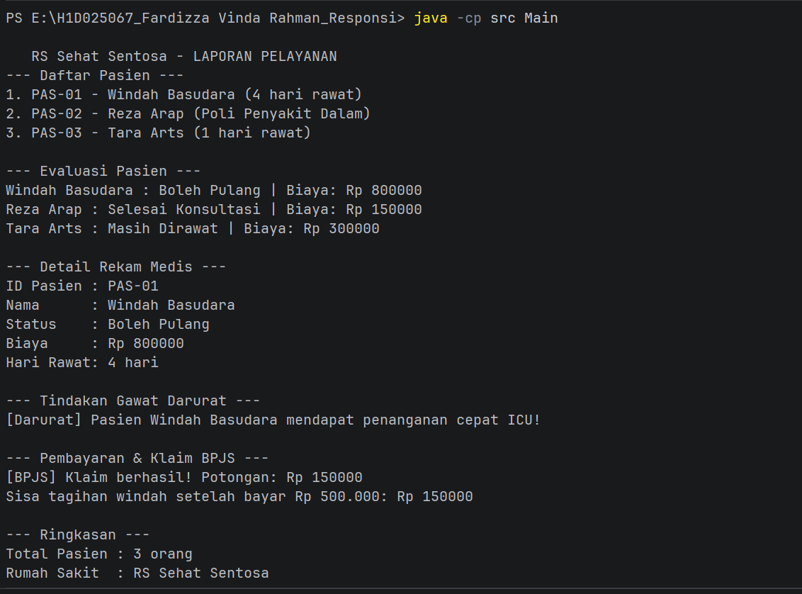

## Identitas
- **Nama**        : Fardizza Vinda Rahman
- **NIM**         : H1D025067
- **Digit Akhir** : 7
- **Tema Sistem** : Rumah Sakit (Sistem Manajemen Pasien Rumah Sakit)

---

## Panduan Kompilasi dan Menjalankan Program

Buka terminal pada direktori utama proyek, kemudian jalankan:

1. Kompilasi source code:
```bash
javac src/*.java
```

2. Eksekusi program:
```bash
java -cp src Main
```

---

## Screenshot Luaran Program



